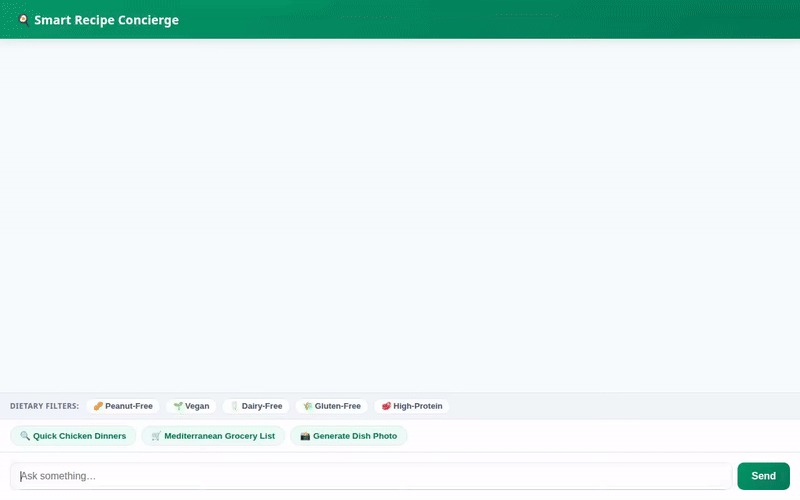

# Smart Recipe Concierge 🥗

An AI-powered recipe search, dietary management, and meal planning assistant built on Google's **Agent Development Kit (ADK)** and deployed to Vertex AI **Agent Runtime**.



---

## 🌟 Key Capabilities & Features

### 📖 1. Firestore Recipe Database Management
- **Recipe Search (`search_recipes`)**: Query recipes by cuisine, dietary tags (vegan, keto, gluten-free, etc.), and max prep time.
- **Detailed Instructions (`get_recipe_details`)**: Retrieve complete ingredient lists and step-by-step cooking instructions.
- **Custom Recipe Creation (`add_recipe`)**: Store new recipes directly in Firestore.
- **Consolidated Grocery List (`generate_grocery_shopping_list`)**: Generate scaled shopping lists aggregated across multiple recipe IDs.

### 🧠 2. Cross-Session Allergy & Preference Memory (Vertex AI Memory Bank)
- **Memory Bank Integration**: Uses `VertexAiMemoryBankService` to record user dietary preferences, allergies (e.g. peanuts, gluten, shellfish), and food sensitivities across turns.
- **Memory Preloading**: Preloads stored memories at the start of conversations to ensure safe, allergen-filtered meal recommendations.

### 📸 3. AI Dish Visuals & Video Generation
- **Gemini Dish Image Generation (`generate_gemini_dish_image`)**: Generates high-quality food photography using `gemini-3.1-flash-lite-image` in the global region.
- **Imagen Photo Generation (`generate_recipe_image`)**: Generates dish images using `imagen-3.0-generate-002` on Vertex AI.
- **Omni Video Preview (`generate_dish_video`)**: Generates short dish video previews using Google's Omni model (`gemini-omni-flash-preview`).
- **Cloud Storage & ADK Artifacts**: Direct byte uploads to Google Cloud Storage public buckets and ADK Playground Artifacts panel.

### 🌐 4. Live Recipe Ideas & Nearby Grocery Store Search
- **TheMealDB API (`fetch_online_recipe_ideas`)**: Fetches online recipe ideas, ingredient lists, and YouTube video tutorials.
- **Google Geocoding API (`geocode_address`)**: Converts addresses and city names to geographic coordinates.
- **Google Places API (`find_nearby_places`)**: Locates nearby supermarkets, grocery stores, and restaurants.

### 🎨 5. Dynamic A2UI & Custom Web Frontend
- **Adaptive Cards (A2UI v0.8)**: Generates structured, display-only card components for recipes, nutritional facts, and ingredient lists.
- **Custom FastAPI Chat Frontend**: Modern web UI featuring quick dietary filter chips, quick prompt shortcuts, and responsive image/card rendering.

---

## 🏗️ Project Architecture

```
smart-recipe-concierge/
├── app/
│   ├── agent.py               # Root ADK agent, tools, callbacks & Memory Bank wiring
│   ├── a2ui_utils.py          # A2UI schema manager & model callbacks
│   └── fast_api_app.py        # FastAPI A2A protocol endpoint
├── frontend/
│   ├── main.py                # FastAPI proxy server for custom chat UI
│   └── static/                # Branded frontend CSS and JavaScript
├── agents-cli-manifest.yaml   # Deployment manifest for agents-cli
├── pyproject.toml             # Python package & dependency definitions
└── README.md                  # Project documentation
```

---

## 🚀 Local Setup & Running Instructions

### Prerequisites
- **Python 3.11+** with `uv` installed (`pip install uv` or `brew install uv`)
- **Google Cloud SDK (`gcloud`)** authenticated with active project permissions
- **GCP Services Enabled**: Vertex AI API, Firestore API, Cloud Storage API, Google Maps API

### 1. Install Dependencies
```bash
uv sync
```

### 2. Seed Initial Recipe Database (Firestore)
```bash
uv run python seed_recipes.py
```

### 3. Launch Agent Playground (ADK Dev UI)
```bash
uv run agents-cli playground
```

### 4. Run Custom Chat Web Frontend
Set your environment variables and launch the FastAPI proxy server:
```bash
export AGENT_ENGINE_RESOURCE_NAME="projects/<PROJECT_ID>/locations/us-east1/reasoningEngines/<ENGINE_ID>"
export AGENT_DIRECTORY="app"
uv run python frontend/main.py
```
*(Open your web browser at the server port displayed in the console output.)*

---

## ☁️ Deployment Instructions

### Deploy to Vertex AI Agent Runtime
```bash
gcloud config set project <PROJECT_ID>
agents-cli deploy
```

---

## 🛠️ Google Cloud Technologies Used
- **Vertex AI Agent Runtime / Reasoning Engine**
- **Gemini 3.1 Flash Lite / Gemini Flash / Imagen 3.0**
- **Gemini Omni Flash Preview (`gemini-omni-flash-preview`)**
- **Vertex AI Memory Bank Service**
- **Google Cloud Firestore**
- **Google Cloud Storage**
- **Google Maps & Places APIs**
